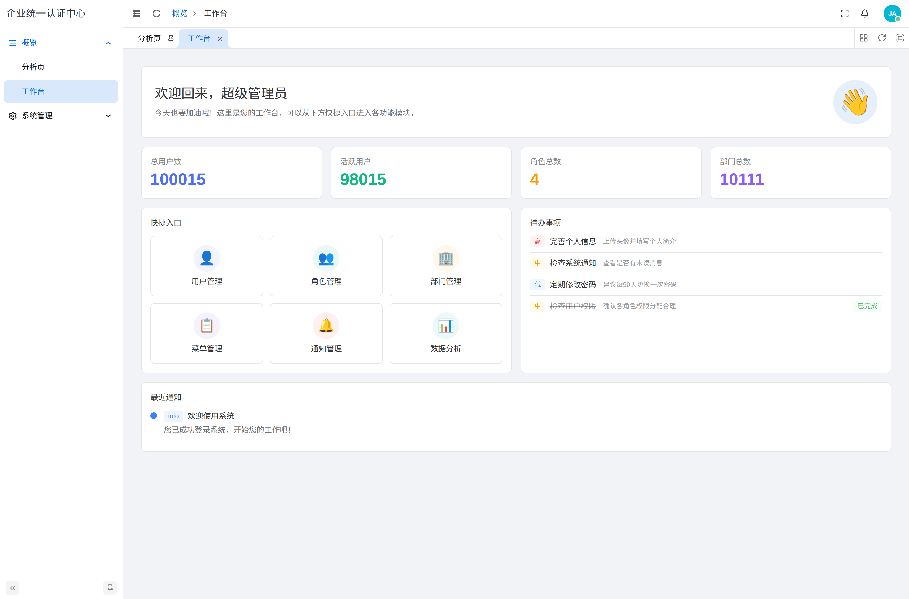
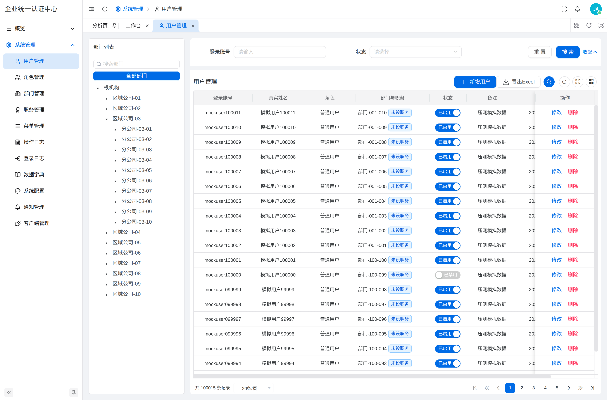
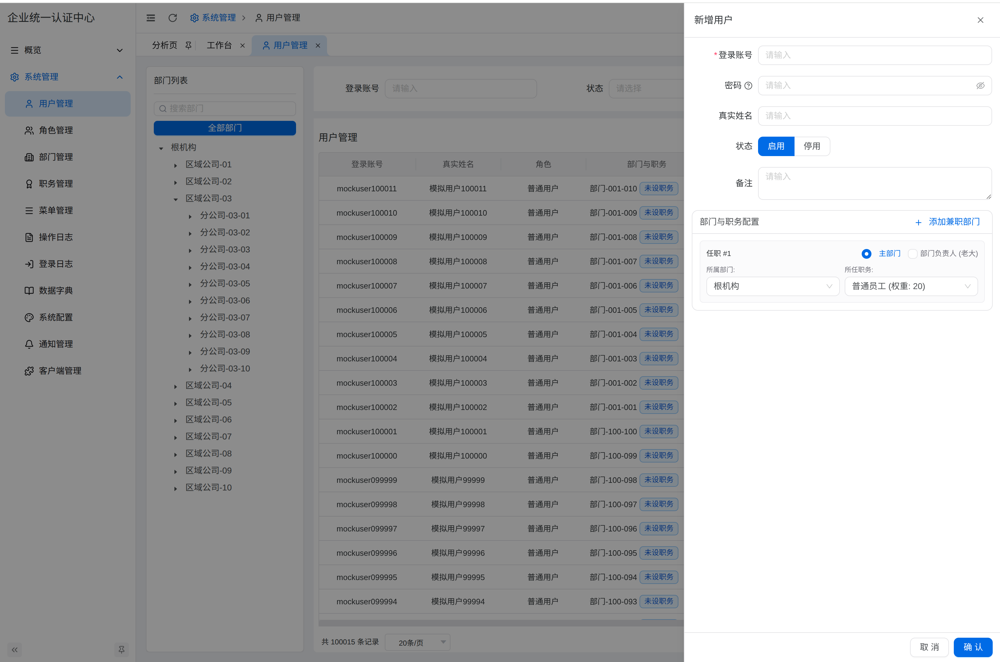
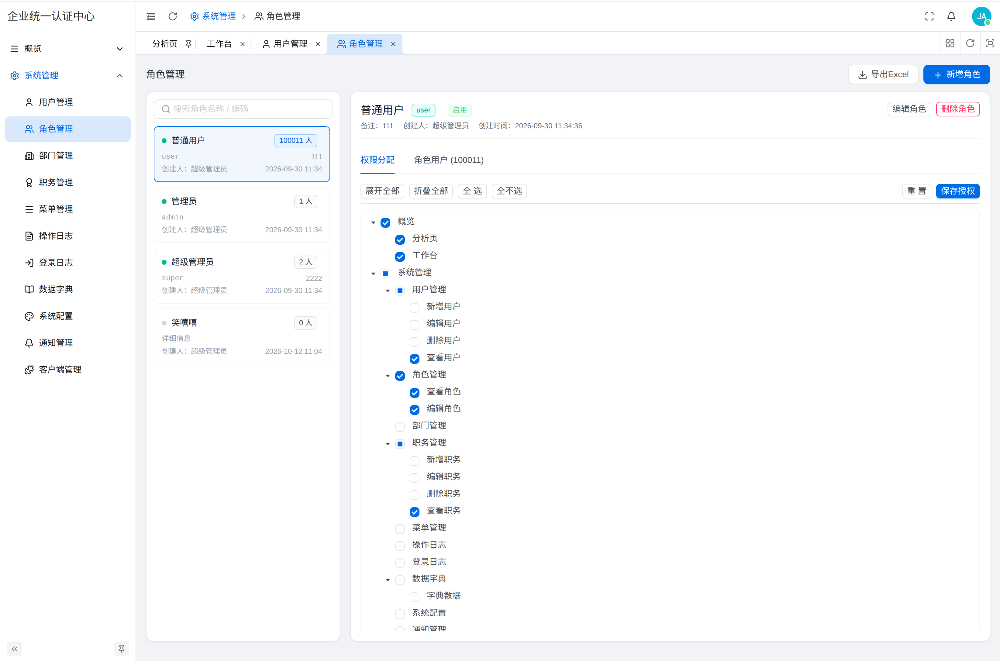
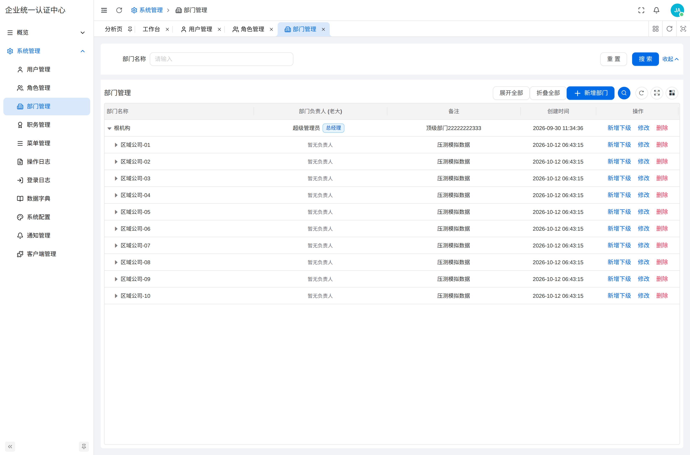
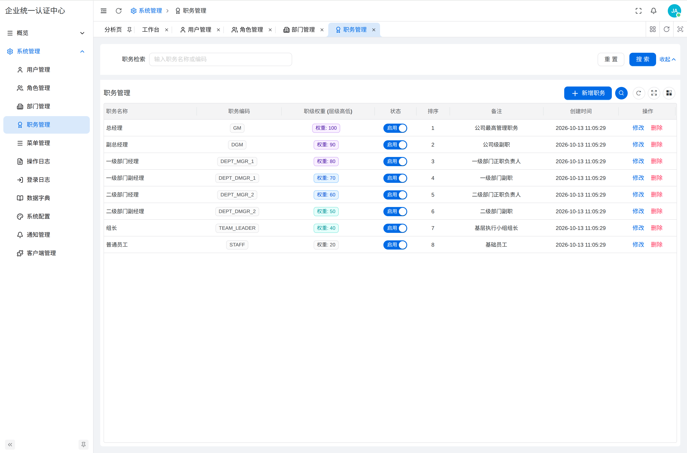
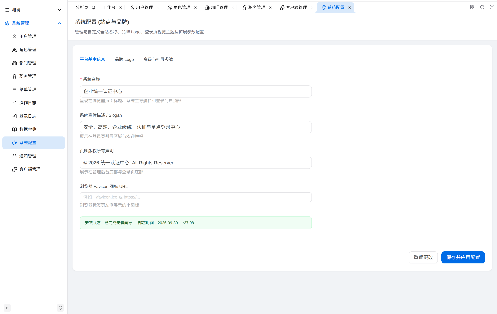

# Janus — 企业级统一认证中心（SSO）

> **Janus**，罗马神话中掌管门户的双面神——所有进出，皆经此门。这正是统一认证中心的定位：一个入口，守卫所有业务系统。

一套认证中心，多个业务系统共用；业务系统引入一个 Starter 依赖、配 4 个参数即可接入，开箱即用。

## 你是否遇到过这些问题

- 公司里每个业务系统都各做一套登录：账号不通、重复造轮子、密码策略和安全管控无法统一
- 想用网关统一认证：架构重、改造成本高，单体项目根本用不起
- 看过一些 SSO 开源组件：偏协议和代码层面，接一个系统要写一大堆胶水代码

Janus 的解法：**独立部署一个轻量认证中心 + 业务侧一个 Spring Boot Starter**。

## 核心优势

1. **一套账号，多个系统共用** — 统一管理用户、角色、部门；一处登录，处处通行；一处登出，全局会话同步失效（SLO）
2. **多部门兼职与职级权重体系** — 创新采用扁平化职级权重设计（无需僵化的父职务树），支持用户跨部门兼职并严格治理唯一主部门；部门自动根据成员职务权重决出“部门老大”，组织架构天然支持矩阵式协同
3. **Starter 开箱即用** — 业务系统只需加一个 Maven 依赖、配 4 个必填项；应用启动时自动注册为客户端，更有高阶 API 一行代码直取部门负责人与人员任职矩阵
4. **业务代码零侵入** — 登录拦截、当前用户上下文注入、接口权限门禁全部由 Starter 提供，业务代码不感知任何 SSO 细节
5. **不强制引入网关** — 单体、多单体都能直接接入，按系统粒度集中管控（启停、签名密钥、回调地址）
6. **离线一键部署** — 提供 Docker 离线安装包（amd64 / arm64 双架构），内外网环境都能快速落地

## 界面预览

**工作台** — 用户/活跃/角色/部门总览，常用功能快捷入口



**用户管理** — 部门树定位 + 万级用户列表，展示主部门与兼职气泡，支持启停、导出



**新增/编辑用户** — 灵活支持多部门兼职与职务分配，单选切换全局唯一主部门，前端提交即时校验



**角色管理** — 角色下的菜单/按钮级权限分配



**部门管理** — 多级部门树，依据职务权重自动计算并呈现部门负责人（老大）



**职务管理** — 扁平化职务维护，按职级权重高低自动决定职级上下级关系，色标高亮职级阶梯



**系统配置** — 站点名称、品牌 Logo、登录页主题在线配置



## 功能清单

**认证中心**（服务端 + 管理端）

- 统一登录 / 登出，单点登出（SLO）全局通知
- 用户、角色、部门管理，角色权限控制
- **职务与职级管理**：扁平化职级权重设计（内置总经理至普通员工 8 级职务），在任人员防删保护
- **多部门兼职与主部门治理**：支持用户跨部门任职不同职务，严格保证全局唯一主部门，旧 `dept_id` 无缝向后兼容
- **部门负责人智能推断**：依据部门成员最高职级权重自动决出部门负责人（老大），兼具显式设置兜底
- SSO 客户端管理：应用启停、签名密钥、回调地址
- 令牌管理、在线用户查看、强制下线
- 对外 OpenApi：职务查询/批量拉取、部门负责人与成员查询、变更事件通知等

**业务接入**（janus-client-spring-boot-starter）

- 自动配置 + 客户端自注册（幂等，先到先得）
- 登录拦截，未登录自动重定向认证中心
- 当前登录用户上下文注入，注解式权限门禁
- 用户 / 机构 / 角色 / 职务本地二级缓存，变更自动失效
- **高阶组织架构 API**：开箱即用的 `getOrgLeader(deptId)`（取部门负责人）、`listOrgMembersWithPositions(deptId)`（取部门成员及职务明细）

## 快速开始

### 1. 本地源码启动（开发调试）

前置要求：JDK 17、Maven 3.8+、Node.js 20+、pnpm 9+、Docker（用于拉起依赖中间件）。

**启动后端**（默认端口 8080，库表由 Flyway 自动创建）：

```bash
# 准备 PostgreSQL 与 Redis（参数与 dev 配置默认值对齐，零改动直跑）
docker run -d --name janus-postgres -p 5432:5432 \
  -e POSTGRES_USER=spec -e POSTGRES_PASSWORD=123456 postgres:14
docker exec janus-postgres createdb -U spec vben_admin
docker run -d --name janus-redis -p 26379:6379 redis:7 redis-server --requirepass janus@123

# 启动
mvn spring-boot:run -pl janus-backend
```

数据库/Redis 连接参数均支持环境变量覆盖（`DB_HOST`、`DB_PORT`、`DB_USERNAME`、`DB_PASSWORD`、`SPRING_DATA_REDIS_HOST`、`SPRING_DATA_REDIS_PORT`、`SPRING_DATA_REDIS_PASSWORD`），详见 [application-dev.yml](janus-backend/src/main/resources/application-dev.yml)。

**启动前端**（默认端口 5666）：

```bash
cd janus-frontend
pnpm install
pnpm dev:antd
```

浏览器访问 [http://localhost:5666](http://localhost:5666)，使用初始账号登录即可进入管理端。

### 2. 离线包部署（生产环境）

```bash
# 构建机：打离线安装包
cd package-files
./build.sh 1.0.0

# 部署机：解压后一键部署
tar xzf janus-install-1.0.0-<日期>.tar.gz -C /opt
cd /opt/janus-install-1.0.0-<日期>
./install.sh
```

详细步骤见 [package-files/DEPLOY.md](package-files/DEPLOY.md)。

### 3. 登录管理端

初始管理员账号：`janus / janus@123`（仅供首次登录，生产环境请立即修改）

### 4. 业务系统接入

```yaml
janus:
  client:
    server-url: http://<认证中心地址>
    client: your-app-id          # 应用标识
    secret-key: your-secret-key  # 接口签名密钥
    client-url: http://<本系统可访问地址>
```

完整对接说明见 [业务对接指南](janus-client-spring-boot-starter/doc/业务对接指南.md)，可运行示例见 [janus-demo](janus-demo)。

## 模块结构

| 目录 | 说明 |
|------|------|
| `janus-backend` | 认证中心服务端（Spring Boot 3 + Sa-Token + MyBatis-Plus + PostgreSQL + Redis） |
| `janus-client-spring-boot-starter` | 业务接入 Starter，jar 内附带全量配置模板与对接文档 |
| `janus-demo` | 业务系统对接示例 |
| `janus-frontend` | 管理端前端（Vue3 + Ant Design Vue，基于 Vben Admin 裁剪） |
| `package-files` | Docker 镜像构建、离线安装包与部署脚本 |

## 技术栈

JDK 17 · Spring Boot 3.3 · Sa-Token · MyBatis-Plus · PostgreSQL 14 · Redis 7 · Vue3 + Vben Admin

## 致谢

- [Sa-Token](https://github.com/dromara/Sa-Token) — 轻量级 Java 权限认证框架，SSO 能力基石
- [Vue Vben Admin](https://github.com/vbenjs/vue-vben-admin) — 管理端前端基座

## License

[MIT](LICENSE)
